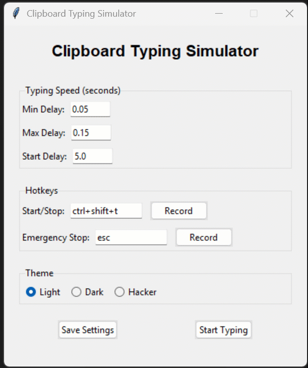
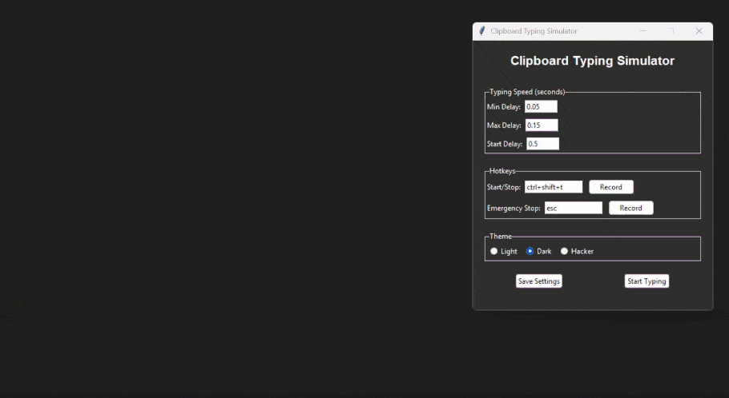

# Clipboard Typer

A customizable typing simulator that types out clipboard content with human-like delays.



## Overview

Clipboard Typer is a Python application that simulates human typing by reading text from your clipboard and typing it out character by character with customizable delays. This tool is useful for:

- Typing into remote consoles and virtual machines that do not accept pasted text
- Recording tutorials and demos with natural-looking typing
- Entering data into applications that block pasting
- Testing input fields with realistic typing patterns

## Changing Settings



## Features

- **Human-like Typing Simulation**: Types text with random delays between keystrokes
- **Customizable Speeds**: Adjust minimum and maximum delays between characters
- **Configurable Start Delay**: Set how long to wait before typing begins
- **Global Hotkeys**: Assign custom keyboard shortcuts for starting/stopping typing
- **Emergency Stop**: Dedicated stop key to immediately halt typing
- **Multiple Themes**: Choose between light, dark, and hacker themes
- **Persistent Settings**: Your preferences are saved between sessions

## Requirements

- Python 3.6+
- Dependencies:
  - `keyboard`
  - `pyperclip`
  - `tkinter` (usually comes with Python)

## Installation

1. Clone the repository:
   ```
   git clone https://github.com/DoingFedTime/PyTyper.git
   ```

2. Navigate to the project directory:
   ```
   cd PyTyper
   ```

3. Install required dependencies:
   ```
   pip install keyboard pyperclip
   ```

4. Run the application:
   ```
   python clipboard-typer.py
   ```

A prebuilt Windows executable is not kept in the repository. See the [Releases](https://github.com/DoingFedTime/PyTyper/releases) page, or build one yourself with `pip install pyinstaller` and `pyinstaller --onefile --noconsole clipboard-typer.py`.

## Usage

1. **Copy text** to your clipboard that you want to type
2. **Configure typing speed**:
   - Set the minimum and maximum delay between keystrokes
   - Set the initial delay before typing starts
3. **Set your hotkeys**:
   - Default hotkey: `ctrl+shift+t` (toggles typing on/off)
   - Default emergency stop: `esc`
4. **Save your settings** by clicking the "Save Settings" button
5. **Position your cursor** where you want the text to be typed
6. **Press your hotkey** or click "Start Typing" to begin typing the clipboard content
7. Use the emergency stop key if you need to immediately stop typing

## Security & Permissions

The `keyboard` library requires administrative/root privileges to register global hotkeys. On some systems, you may need to run the application with elevated permissions.

## Customization

### Themes

Clipboard Typer comes with three built-in themes:
- Light: Default clean interface
- Dark: Easier on the eyes in low-light environments
- Hacker: Matrix-inspired green on black theme

### Settings File

Your settings are saved in `clipboard_typer_settings.json` in the directory you start the application from. You can manually edit this file if needed.

## Troubleshooting

### Hotkeys Not Working

1. Ensure you've clicked "Save Settings" after changing hotkeys
2. Try using different key combinations if a particular hotkey doesn't work
3. Some applications may block global hotkeys
4. Run the application with administrator privileges

## License

This project is licensed under the GNU General Public License v3.0. See the [LICENSE](LICENSE) file for details.

## Acknowledgments

- Thanks to the creators of the `keyboard` and `pyperclip` libraries

---

Created by [DoingFedTime](https://github.com/DoingFedTime)
